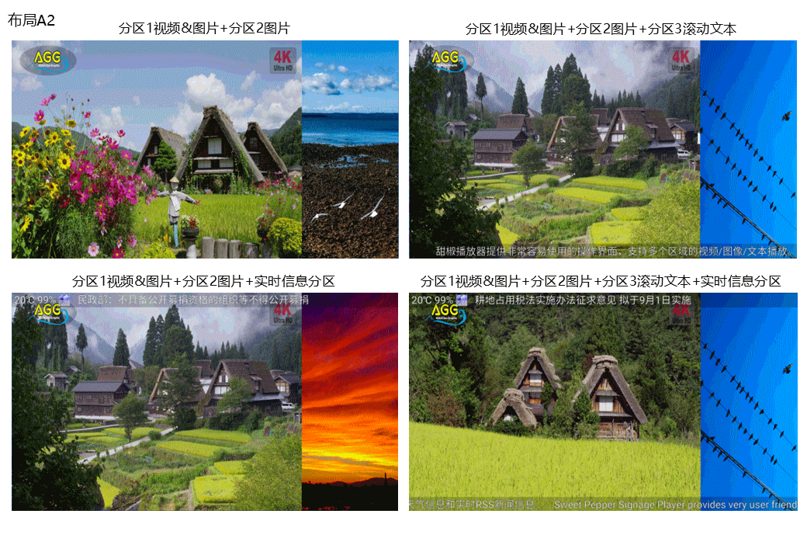
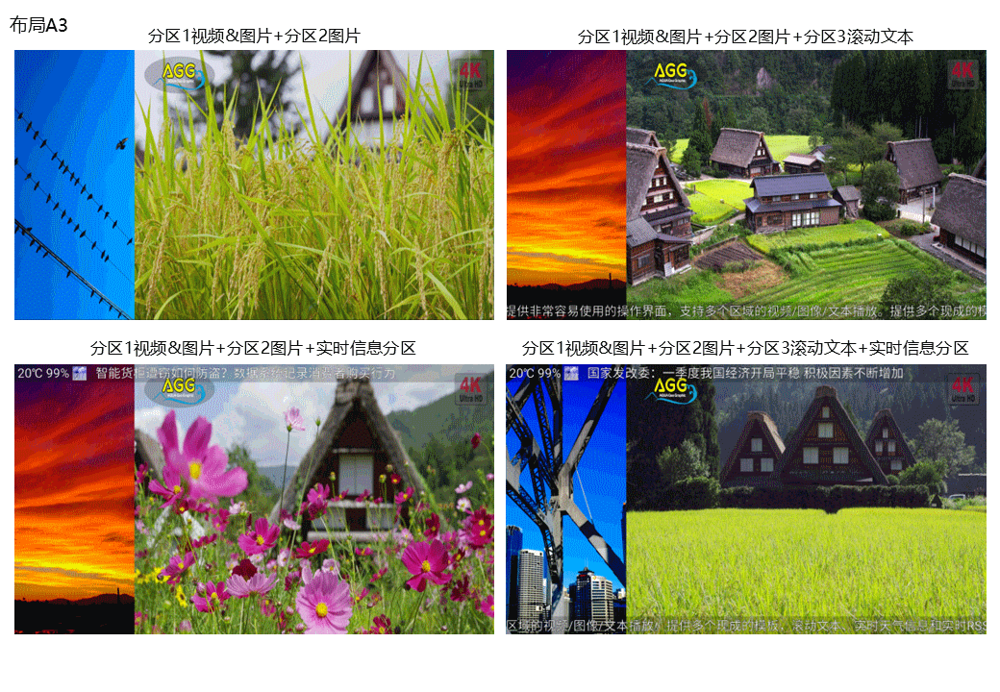
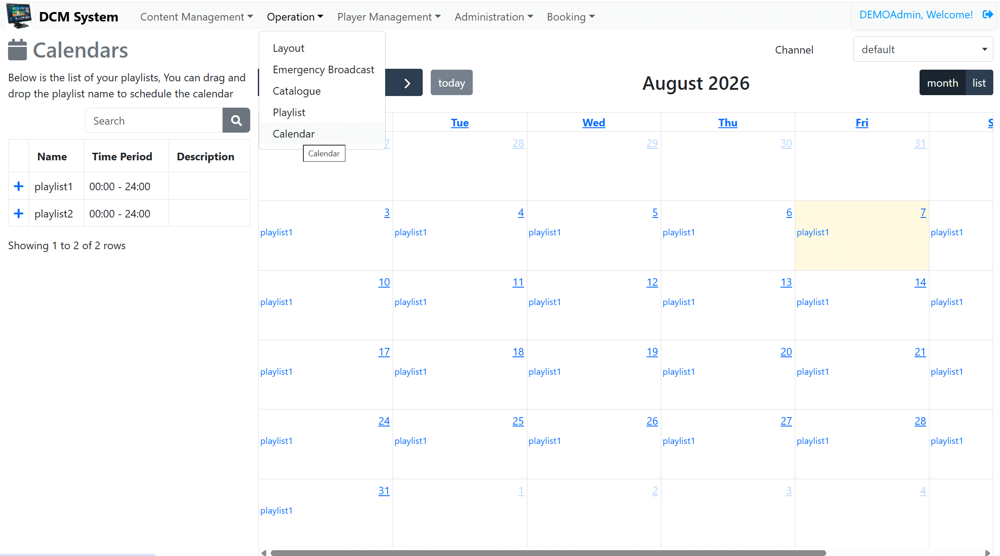
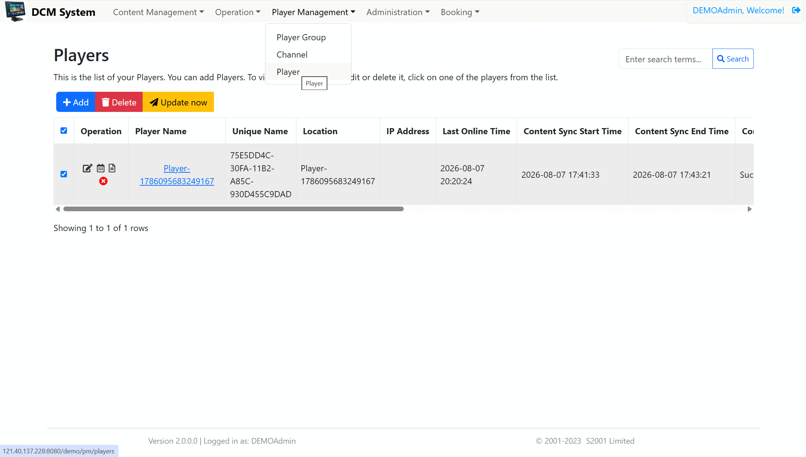

# dcm-flutter

中文 | [English](./README_en.md)

DMC Digital Signage Player

基于 Flutter 和 Dart 构建的跨平台全屏数字标牌与媒体播放解决方案，适用于多区域显示布局场景。系统可将屏幕划分为多个可自定义大小和位置的播放区域，并支持在本地文件与网络资源之间切换播放各类媒体内容。

## 最新更新（v1.1.1+49）

### Android 多屏独立输出

播放器可识别 Android 设备上的多块显示器（如 HDMI 扩展屏），并为每块扩展屏创建独立的 Flutter 渲染引擎（基于 `Presentation`），各屏独立播放各自的输出内容。

- 显示器枚举与热插拔：原生通道 `dcm/multiscreen`（`MultiScreenPlugin`）枚举全部显示器，热插拔时自动为新增的扩展屏创建引擎、为移除的屏销毁引擎。
- 稳定输出映射：`DisplayOutputRegistry` 以「显示器名称 + 物理分辨率」持久化输出序号（主屏固定为 0，扩展屏从 1 开始），拔插后同一块屏仍对应原输出，不会串屏。
- 使用方式：皮肤 INI 中的 `DisplayMonitor` 指定输出序号（0=主屏，1、2…=扩展屏）；`DisplayMonitor=0,1` 等多值仅用于桌面拼接，Android 各屏物理独立时按单屏各自渲染。

### 桌面多屏拼接与混合 DPI

- 修复桌面版多屏拼接（span）窗口不贴合的问题：窗口现在会精确覆盖所选显示器的并集。
- 混合 DPI 支持：并集按物理像素计算后再换算回画布坐标，不同缩放比例（如 100% + 150%）的显示器拼接时窗口不再错位。
- 显示器热插拔/分辨率/DPI 变化时自动重新计算画布并重排播放区域。

### 多播放器同步播放（CMD_SYNC_PLAY）

支持 CMS 通过 WebSocket 广播统一下发「同一时刻开播」命令，实现多台播放器同步播放。

- 时钟：`ServerClock` 在内存中维护服务器时间偏移（不改系统时间、无需 root），通过 WebSocket 消息时间戳自动校时，也可配置 NTP 时间服务器精化。
- 命令：CMS 发送 `MessageWrapper{ command: CMD_SYNC_PLAY(27), timestamp: <服务器当前毫秒>, payload: SyncPlayCommand }`；`SyncPlayCommand` 字段：`content`（DCM 文件名，空=重载当前排期）、`startTime`（服务器毫秒开播时刻，建议当前时间 +2~5 秒）、`tolerance`（过期容忍毫秒，默认 5000）。
- 播放器行为：到点时刻同时执行——`content` 为空则重载当前排期，非空则播放指定 DCM 文件；过期超过容忍值的命令会被忽略；重复命令以最新为准。

### 图片幻灯片过渡效果

当节目数据 `arrTransition` 非空时，图片轮播启用过渡动画，支持 jQuery UI 风格效果：fade、slide、blind、clip、drop、fold、puff、scale、size、bounce、pulsate、shake、explode（3×3 分块）、highlight、transfer；名称解析兼容大小写、空格、连字符、中文别名与数字 0–15，`none` 表示禁用。

### 其它改进

- 修复 Android 平台「文件已存在仍重复下载」：统一路径分隔符与大小写、2 秒时间容差、正式目录与临时目录双重查找。
- 播放器内核（media_kit）改为懒加载，按需创建，降低启动开销。
- 应用构建版本号与 GitHub 发布版本同步（1.1.1+49）。

## 实时监控推流（WebRTC）

播放器可将当前播放画面实时推送给 CMS，用于远程监看。信令复用已有的 CMS WebSocket 通道，**不额外建立 WebSocket 连接**；媒体流走标准 WebRTC（SRTP），播放器作为 SDP **answerer**。

### 命令定义

`websocket_def.protobuf` 中新增：

| 命令 | 值 | 方向 | 载荷 |
| --- | --- | --- | --- |
| `CMD_WEBRTC_START` | 28 | CMS → 播放器 | `StartWebRtcCommand` |
| `CMD_WEBRTC_OFFER` | 29 | CMS → 播放器 | `RtcSdpCommand`（`type="offer"`） |
| `CMD_WEBRTC_ANSWER` | 30 | 播放器 → CMS | `RtcSdpCommand`（`type="answer"`） |
| `CMD_WEBRTC_ICE` | 31 | 双向 | `RtcIceCommand` |
| `CMD_WEBRTC_STOP` | 32 | CMS → 播放器 | 空 |

```protobuf
message StartWebRtcCommand {
  string targetId  = 1;  // CMS 会话 ID，原样回传
  int32  displayId = 2;  // 显示器索引，-1 = 主屏（仅桌面生效）
  int32  width     = 3;
  int32  height    = 4;
  int32  frameRate = 5;  // 默认 30
  int32  bitrate   = 6;
  bool   withAudio = 7;  // 系统音频（桌面平台）
}

message RtcSdpCommand {
  string targetId = 1;
  string sdp      = 2;
  string type     = 3;  // "offer" / "answer"
  string fromId   = 4;  // 发送方标识，播放器当前回传空串
}

message RtcIceCommand {
  string targetId      = 1;
  string fromId        = 2;
  string candidate     = 3;
  string sdpMid        = 4;
  int32  sdpMLineIndex = 5;
}
```

### 时序

```text
CMS ──CMD_WEBRTC_START(28)──▶ 播放器    启动采集、创建 PeerConnection
CMS ──CMD_WEBRTC_OFFER(29)──▶ 播放器    setRemoteDescription
播放器 ──CMD_WEBRTC_ANSWER(30)──▶ CMS   createAnswer + setLocalDescription
CMS ⇄ 播放器  CMD_WEBRTC_ICE(31)         双向 ICE candidate
CMS ──CMD_WEBRTC_STOP(32)──▶ 播放器      停止推流并释放资源
```

`offer` 若早于 PeerConnection 就绪（Android 授权弹窗耗时）会被缓存，连接建立后自动补处理；远端 ICE candidate 在 PeerConnection 创建前也会排队。

### 采集实现

- **桌面（Windows / macOS / Linux）**：`desktopCapturer.getSources()` 枚举显示器，按 `displayId` 选中后用 `getDisplayMedia` 采集，零配置。
- **Android**：`getDisplayMedia` 内部使用 `MediaProjection` + `ScreenCapturerAndroid`，首次会弹出系统屏幕录制授权框。由于 Android 14+ 强制要求调用 MediaProjection 前已有 `mediaProjection` 类型前台服务，播放器会先启动 `WebRtcProjectionService`（常驻通知「正在通过 WebRTC 推流屏幕画面」），停止推流时自动关闭。受系统限制，首次授权需应用处于前台。
- **STUN**：默认使用 `stun:stun.l.google.com:19302` 与 `stun:stun1.l.google.com:19302`；跨 NAT 场景建议自行部署 TURN 并替换 `_stunServers`。

### 涉及文件

- `lib/proto/websocket_def.*`、`websocket_def.protobuf`：命令与消息定义
- `lib/backend/services/webrtc_publishing_service.dart`：采集 + PeerConnection + 信令收发
- `lib/backend/net/cms_websocket_service.dart`：WebSocket 命令分发与发送桥接
- `android/app/src/main/kotlin/com/platform/player/WebRtcProjectionService.kt`：mediaProjection 前台服务
- `android/app/src/main/AndroidManifest.xml`：`FOREGROUND_SERVICE_MEDIA_PROJECTION` 权限与服务声明

## 产品概览

本项目是一款面向数字标牌、智能零售展示、信息墙与媒体展示场景的专业多屏播放系统。它支持在单屏或多屏环境下，按区域组合播放多种内容，并实现统一管理与灵活轮播。

### 核心功能

- 支持在全屏模式下播放大屏、墙面显示器或数字标牌内容。
- 支持灵活的多区域布局，可自定义分区数量、区域尺寸与位置。
- 支持播放多种内容类型，包括视频、媒体流、图片、文本、天气、时钟、PPT、PDF、HTML、滚动文本以及图片幻灯片。
- 支持多个节目或播放列表在不同区域之间轮播与排程。
- 支持播放本地媒体文件，也支持在线/网络内容。
- 支持系统开机自动启动。
- 可作为单机播放器独立运行，也可与 CMS 服务同步更新，实现远程内容管理与集中控制。
- 支持通过 CMS 向播放器发布紧急消息。
- 支持 Windows、macOS、Linux、Android、iOS 和 Web 等多平台部署。

### 亮点摘要

- 面向数字标牌与信息展示的多区域、多内容播放能力。
- 支持节目轮播与 CMS 同步管理，便于集中更新。
- 基于 Flutter 与 Dart 提供统一的跨平台交付能力。

### 典型应用场景

- 企业前台与接待展示屏
- 零售门店与智能购物场景
- 公共信息墙与交通枢纽终端
- 教育培训与会议演示屏幕
- 通过排程更新内容的远程数字标牌管理

### 平台与技术

本应用采用 Flutter 与 Dart 实现，提供统一的跨平台代码能力，同时支持独立本地播放与 CMS 演示系统 http://121.40.137.228:8080/demo 的同步更新。

[](https://github.com/s2001wincrown/dcm-flutter/actions)
[](https://github.com/s2001wincrown/dcm-flutter/releases)  [](https://github.com/orgs/s2001wincrown/projects/3)


支持平台：Windows、macOS、Linux、Android、iOS 和 Web。

## 平台支持版本

- Flutter SDK：当前值 `>=3.1.3 <4.0.0`（`pubspec.yaml`）；建议使用 Flutter 3.29.0 及以上版本。
- Android：当前值在 `android/app/build.gradle` 中使用 `minSdkVersion flutter.minSdkVersion` 和 `targetSdkVersion flutter.targetSdkVersion`；建议使用与当前 Flutter SDK 兼容的 Android SDK 配置。
- macOS：当前值 `macOS 10.14.6`（`macos/Podfile`）；建议使用 `macOS 10.14.6` 或更高版本。
- Windows：当前支持 Flutter Windows 桌面；建议在 Windows 10/11 平台上构建和运行。
- Linux：当前支持 Flutter Linux 桌面；建议安装 GTK 3 和 `libmpv` 运行时依赖。
- Web：当前支持 Flutter Web 部署；建议使用现代浏览器。

### 详细平台支持

| 平台 | 当前值 | 建议值 |
| --- | --- | --- |
| Android | 当前使用 `android/app/build.gradle` 中的 Flutter 管理值：`minSdkVersion flutter.minSdkVersion` / `targetSdkVersion flutter.targetSdkVersion` | Android 5.0+（API 21+） |
| iOS | 受 Flutter SDK 管理，具体值取决于运行时的 iOS 项目配置 | iOS 9+（建议使用更高版本） |
| macOS | 当前最低 `macOS 10.14.6`（`macos/Podfile`） | macOS 10.14.6+ |
| Windows | 当前支持 Flutter Windows 桌面构建 | Windows 10/11 |
| Linux | 当前支持 Flutter Linux 桌面构建 | 现代 GNU/Linux 发行版，需 GTK 3 和 `libmpv` |
| Web | 当前支持 Flutter Web 部署 | 现代浏览器 |

## 产品界面展示

<table>
  <tr>
    <td>
      
    </td>
    <td>
      
    </td>
  </tr>
  <tr>
    <td>
      
    </td>
    <td>
      
    </td>
  </tr>
</table>

## 首次启动设置

首次启动且尚未完成本地配置时，应用会显示播放器初始化页面。请按以下步骤完成设置：

1. 如果已插入可移动存储，应用会自动查找其中有效的 `Server.txt`。找到后会将文件复制到应用数据目录，读取并应用服务器及播放器信息，自动保存设置并进入播放界面。
2. 如果未找到有效的 `Server.txt`，初始化页面会继续显示原有设置表单，并在页面停留期间持续检查可移动存储。之后插入含有效 `Server.txt` 的存储时，应用会自动导入配置并进入播放界面；如果没有有效文件，则可继续手动设置。
3. 手动配置时，可选：在 **播放器名称** 中输入当前播放器的名称。
4. 可选：在 **地点** 中输入播放器所在的位置。
5. 在 **内容管理系统网址** 中输入 CMS 服务地址，例如 `http://121.40.137.228:8080/demo`。
6. 点击 **保存并继续**。应用会保存配置、加载播放器设置并启动内容同步服务，然后进入播放界面。
7. 如需独立本地播放，点击 **Local Player**。应用会生成关闭 CMS 内容自动同步的 `dcm.dat` 配置，并进入播放界面。
8. 如果暂时不想配置，点击 **取消并退出**；桌面端会退出应用，Android/iOS 设备会关闭当前应用页面。

**组织代码**、**频道** 和 **设置分组** 仍会使用程序内置的默认值保存到播放器配置中，但不会显示在设置页面。

`Server.txt` 需要包含有效的 HTTP 或 HTTPS CMS 服务器地址。自动导入成功后，应用会按常规初始化流程保存播放器信息并加载 CMS 播放设置。

## 局域网 HTTP 管理

原生应用启动时会在 `0.0.0.0:8765` 启动 HTTP 管理服务（Flutter Web 不支持 `dart:io` Server），并提供设备托管的中文管理页面。打开应用 **设置 → HTTP 管理**，查看播放机的局域网地址和 Bearer 令牌；令牌可在该页面重新生成。浏览器页面只在当前浏览器本地保存令牌。

所有管理 API（除 `/` 和 `/health` 外）均要求 `Authorization: Bearer <token>`。管理接口包括：

- `GET /api/status`、`GET /api/capabilities`：在线状态、当前节目、网络地址、存储空间与平台能力。
- `GET /api/settings`、`PATCH /api/settings`：播放器音量、自动播放，以及白名单内的 `dcm.dat` 全局设置。`dcm` 可修改的键为 `Global Setting.Auto Reload Idle Duration`、`Global Setting.MultiMonitor`、`Global Setting.VideoSetting`、`Global Setting.Video_Render`、`Global Setting.MaxContentDuration`、`Global Setting.MaxDefaultEvent`、`Global Setting.EventMultiGroup`、`Global Setting.PlaybackSettings`、`Global Setting.PlayMode`、`Global Setting.EventTimeout`、`Global Setting.ZoneThread`、`Global Setting.Background Color`。
- `GET /api/playlists`、`PUT /api/playlists/current`、`POST /api/playback/reload`、`POST /api/playback/insert`、`POST /api/playback/restore`：播放列表、切换节目、刷新、插播 Catalogue 和恢复默认播放。
- `POST /api/catalogues`、`POST /api/playlists`、`POST /api/schedules/month`：以 JSON 创建 Catalogue、播放列表和月日历。Catalogue 请求包含 `name`、`layout`（`width`、`height`、`zones`，每个分区含 `left`、`top`、`width`、`height`）和 `products`；各产品含 `zones`，每个 zone 含 DCM 内容类型编号 `type` 和素材文件名 `file`，其数量必须等于 layout 分区数。播放列表请求包含 `name` 和 `items`（每项为 Catalogue 名称 `catalogue`）；月日历请求包含 `month`（`YYYYMM`）、可选 `channel` 和 `days`（包含 `day`、`event`、可选 `events`）。
- `POST /api/content/upload?category=...&name=...`：以原始二进制请求体上传素材；支持的 category 为 `images`、`video`、`web`、`text`、`catalogues`、`playlists`。上传不会覆盖已有文件。
- `POST /api/content/validate`：用 `{"kind":"playlist|catalogue","name":"..."}` 校验内容；`DELETE /api/content/expired` 清理过期月日历文件。
- `GET /api/diagnostics/screenshot`、`GET /api/diagnostics/logs`、`POST /api/diagnostics/restart`：截屏、下载应用日志、请求重启设备。

不要将该 HTTP 服务直接暴露到互联网或不可信网络：当前服务使用明文 HTTP，Bearer 令牌和上传内容可能被同一网络上的监听者截获。请限制在可信局域网/VPN 内访问；如需跨不可信网络管理，应在可信 TLS 反向代理之后使用。

硬件温度、网络接口配置、系统时间修改、硬件亮度/方向/输出分辨率、播放事件日志和固件升级目前没有可用的平台适配器；相应功能会在 `/api/capabilities` 中标记，并通过 HTTP 501 明确返回不可用原因。手动 CMS 同步通过正在运行的 CMS 后台 worker 排队；worker 未运行时返回 HTTP 503。Catalogue 布局支持设置分屏区域。

## 浮动菜单

在播放画面快速连续点击两次，可打开底部浮动菜单。菜单包含以下功能：

- **设置**：打开应用设置页面。
- **重新初始化**：重新打开播放器初始化页面。输入 CMS 地址后保存，应用会重新获取播放设置和内容类型设置文件，并返回播放界面；播放器名称和地点可以留空。
- **退出**：退出应用。
- **返回**：关闭浮动菜单。

## 应用启动与 CMS 内容同步

1. 从 GitHub Releases 页面下载适用于当前平台的安装包或应用程序：<https://github.com/s2001wincrown/dcm-flutter/releases>。
2. 安装并启动应用。首次启动时，应用界面可能先显示黑屏，这属于正常状态，系统会自动与演示 CMS 系统 http://121.40.137.228:8080/demo 同步内容。
3. 内容同步完成后，应用会自动进入播放状态，开始按照当前节目内容进行展示。
4. 如果需要切换播放内容，请先登录 CMS 演示系统，用户名：`DEMOUser`，密码：`DEMOUser`。
5. 在 Calendar 功能中切换系统预置的 Playlist。
6. 打开 Player 功能，进入 Player 列表（见 `./screenshots/cms2.png`），选择需要更新的 Player，再点击 `Update Now`，将最新内容推送到 Player。
7. Player 接收到更新后会立即切换到新的播放内容。

<table>
  <tr>
    <td>
      
    </td>
    <td>
      
    </td>
  </tr>
</table>

### 使用 Anime4K 着色器

参考 [Anime4K](https://github.com/bloc97/Anime4K) 官方的 GLSL/MPV 安装教程, 下载 template files.

**顶部菜单 -> 应用偏好设置 -> 存储 -> 打开应用数据文件夹**, 把 `mpv.conf`, `input.conf`, `shaders 文件夹` 复制到数据文件夹下.

启用 **应用偏好设置 -> 播放器 -> 允许 libmpv 使用配置文件** 选项, 重启应用.

## 开发说明

如需在本地构建并运行此项目，首先请根据 [官方教程](https://docs.flutter.dev/get-started/install/) 配置 Flutter 环境，并使用不低于 **3.29.0** 的 Flutter 版本。

环境准备完成后，可执行以下命令安装所需依赖：

- `flutter pub get`
- `dart run whisper4dart:setup --prebuilt`

### Windows

在构建 Windows 版本前，先准备 `libmpv` 运行时依赖：

- `dart run libmpv_dart:setup --platform windows`

随后生成 Windows 可执行程序：

- `flutter build windows`

### Linux

配置完 Flutter 后，请通过系统包管理器或其他方式安装 `libmpv-dev`。

生成 Linux 可执行程序：

- `flutter build linux`

### macOS

生成 macOS 可执行程序：

- `flutter build macos`

### Android

> 请在平板设备上运行。

生成 APK 安装包：

- `flutter build apk`

## 发布说明

本项目支持根据 git tag 自动同步 `pubspec.yaml` 中的版本号，并通过脚本一键执行构建与发布。

### 版本同步方式

在仓库根目录执行：

```bash
git fetch --tags origin
python tools/sync_version_from_git_tag.py
```

脚本会按优先级读取最新 tag：

1. `git describe --tags --abbrev=0`
2. 本地最新 tag
3. 远端最新 tag
4. 若没有 tag，则保持现有版本不变

并会自动去掉 `v` 前缀，例如：

- `v1.0.1` -> `1.0.1`

### 本地发布脚本

在 Windows PowerShell 中执行：

```powershell
./tools/release.ps1 -Target windows
```

可选参数：

```powershell
./tools/release.ps1 -Target all
./tools/release.ps1 -Target linux -SkipBuild
./tools/release.ps1 -Target windows -GenerateNotes
./tools/release.ps1 -Target windows -AutoCommit -AutoTag
./tools/release.ps1 -Target windows -AutoCommit -AutoTag -AutoPush
./tools/release.ps1 -Target windows -AutoCommit -AutoTag -AutoPush -PublishGithub -GithubToken YOUR_GH_TOKEN
```

脚本会自动完成：

- 拉取远端 tag
- 同步版本到 `pubspec.yaml`
- 可选提交 `pubspec.yaml` 变更
- 可选创建并推送 git tag
- 生成 release notes
- 构建指定平台的产物
- 可选上传到 GitHub Release

### 完整发布工作流

如果你希望一键完成“版本同步 + 提交 + tag + 推送 + 发布”，可以直接运行：

```powershell
./tools/release.ps1 -Target windows -AutoCommit -AutoTag -AutoPush -PublishGithub -GithubToken YOUR_GH_TOKEN
```

它会做这些事：

1. 拉取最新远端 tag
2. 使用 git tag 更新 `pubspec.yaml` 版本
3. `git add pubspec.yaml`
4. `git commit -m "chore: sync version to X.Y.Z"`
5. 创建 tag，例如 `v1.0.1`
6. `git push origin HEAD`
7. `git push origin --tags`
8. 构建产物并上传到 GitHub Release

### 直接上传到 GitHub Release

如果已安装 GitHub CLI，并设置了 `GH_TOKEN`，可直接执行：

```powershell
$env:GH_TOKEN = 'YOUR_GITHUB_TOKEN'
./tools/release.ps1 -Target windows -PublishGithub
```

或者在命令行中传入：

```powershell
./tools/release.ps1 -Target windows -PublishGithub -GithubToken YOUR_GITHUB_TOKEN
```

> 若网络异常或远端拉取 tags 失败，脚本会保留本地 tag，并继续后续流程，不会因为网络问题中断发布。

## 参与贡献

欢迎参与本项目的建设。如果您在使用过程中发现问题、希望反馈缺陷或提出功能建议，请 [新建一个 issue](https://github.com/s2001wincrown/dcm-flutter/issues/new)。

我们也非常欢迎通过 Pull Request 提交代码改进、平台适配与新功能支持。

## Star History

[](https://star-history.com/#s2001wincrown/dcm-flutter&Date)
